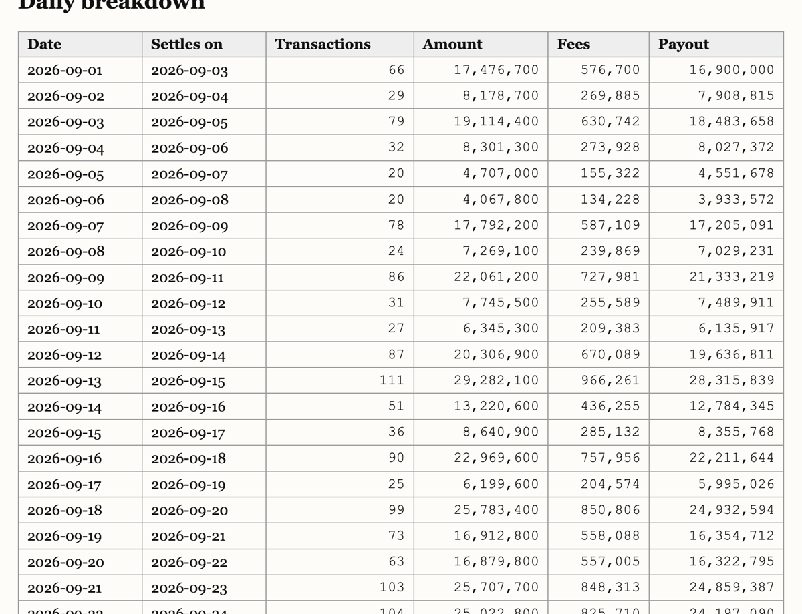
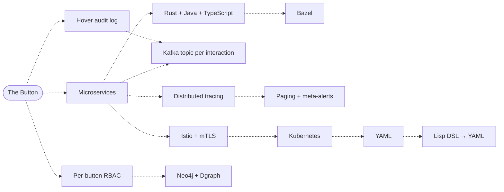

# shipping-a-button

> **One button. Every stakeholder. Total alignment.**

| Document control | |
|---|---|
| Document ID | `SAB-README-001` |
| Classification | PUBLIC (regrettably) |
| Version | 0.1.0-draft |
| Status | Pre-Alignment |
| Owner | Office of the Chief Button Officer |
| Executive Sponsor | <a href="https://www.youtube.com/watch?v=xE9W9Ghe4Jk&t=524s"></a> Initiated the programme after reading a tweet |
| Review cadence | Whenever someone has an opinion |
| Supersedes | A two-day estimate |

---

## Table of Contents

0. [Executive Summary](#0-executive-summary)
1. [Provenance](#1-provenance)
2. [Normative Language](#2-normative-language)
3. [Governing Principles](#3-governing-principles)
4. [The Deliverable](#4-the-deliverable)
5. [Stakeholder Advisory Register](#5-stakeholder-advisory-register)
6. [Compromise Register](#6-compromise-register)
7. [Projected Complexity Cascade](#7-projected-complexity-cascade)
8. [Delivery Roadmap](#8-delivery-roadmap)
9. [Quarterly Button Delivery Metrics](#9-quarterly-button-delivery-metrics)
10. [Long-Range Strategic Horizon](#10-long-range-strategic-horizon)
11. [Operating Instructions](#11-operating-instructions)
- [Appendix A — Glossary](#appendix-a--glossary)
- [Appendix B — Disclaimers](#appendix-b--disclaimers)

---

## 0. Executive Summary

A chief executive requested a simple dashboard with one button and allotted two days.

This repository delivers that dashboard while **accepting, without exception, every piece of architectural, operational and regulatory guidance** offered to the developer in the source material — graph databases, a message topic per user interaction, a service mesh, three JavaScript runtimes, two Rust UI frameworks, a Java money service, a Bazel monorepo, SAML single sign-on, per-button access control, hover-level audit logging, and, ultimately, a Lisp DSL that compiles to YAML.

The functional scope never changes. Only the architecture does.

The dashboard is therefore not the product. **The product is the measurement of what each piece of advice cost** — and, more importantly, the record of how each over-engineered decision went on to justify the next one.

## 1. Provenance

This programme was initiated in response to the following stakeholder communication:

[](https://www.youtube.com/watch?v=xE9W9Ghe4Jk)

*"Shipping a button in 2026…"* by **Kai Lentit** ([programmers are also human](https://www.youtube.com/@programmersarealsohuman5909)). Watch it first; this document assumes you have.

This project is an independent homage. It is not affiliated with, endorsed by, or reviewed by the creator. All advice below is paraphrased; for the original delivery, timing and costumes, see the video.

## 2. Normative Language

The key words **MUST**, **MUST NOT**, **SHALL**, **SHOULD** and **MAY** in this document are to be interpreted as described in [RFC 2119](https://www.rfc-editor.org/rfc/rfc2119).

In addition, the following key words are defined for the purposes of this programme:

| Key word | Meaning |
|---|---|
| **AT SCALE** | Applicable to at least 200,001 users, irrespective of how many users exist. |
| **OBVIOUSLY** | Asserted by a stakeholder without supporting evidence. Binding. |
| **LATER** | A commitment that SHALL be recorded in the roadmap and MAY be honoured. |

## 3. Governing Principles

**P-1. Principle of Total Acceptance.**
Every piece of advice in scope MUST be implemented as stated. A desire to reduce scope, however reasonable, is not a ground for compromise; it is the phenomenon under observation.

**P-2. Permissible Grounds for Compromise.**
A piece of advice MAY be adapted if, and only if:
1. it cannot be satisfied simultaneously with another piece of advice when both are read literally; or
2. satisfying it requires money or a third-party account.

Every adaptation SHALL be entered in the [Compromise Register](#6-compromise-register).

**P-3. Invariance of Functional Scope.**
The deliverable defined in §4 MUST remain identical across all chapters. Features SHALL NOT be added or removed. Only architecture changes, so that measurements remain comparable.

**P-4. Frozen Baseline.**
Chapter 0 is the control group. After its completion it MUST NOT be modified or instrumented, save to correct a defect in the baseline itself — in which event all chapters SHALL be re-measured.

**P-5. Numerical Fidelity.**
A chapter is complete only when, given the same seed, it produces the **same figures** as the baseline. A chapter that produces different numbers has not shipped the button; it has shipped an opinion.

## 4. The Deliverable

A merchant-facing settlement reporting portal for **Acme Payments**, a fictional payment service provider.

### 4.1 Functional requirements (invariant)

| ID | Requirement |
|---|---|
| FR-1 | Settlement summary for a selected period: transaction total, fee total, expected payout. |
| FR-2 | Daily table: transaction count, amount, fees and payout per day. |
| FR-3 | **The Button.** Download the settlement statement as CSV. |
| FR-4 | A panel reporting how many times FR-3 has been pressed. The infrastructure built for the button SHALL be used to count the button. |
| FR-5 | An API serving FR-1 to FR-4. |

### 4.2 Data

All data is synthetic, generated deterministically from a fixed seed. No real company, merchant or transaction is represented.

```
Distributor
 └─ Agency
     └─ Merchant                 ← tenant; unit of portal login
         ├─ Transaction          amount, method, approved/cancelled, timestamp
         │   └─ Fee              rate (basis points), amount
         └─ Settlement           date, transaction total, fee total, payout
```

Monetary amounts are integers in the minor unit. Rates are integers in basis points. Floating point is not permitted anywhere money is concerned, a position on which every stakeholder, unusually, agrees.

### 4.3 Reference rendering

As delivered by Chapter 0. Later chapters SHALL render the same figures; they MAY render them less legibly.



## 5. Stakeholder Advisory Register

*Also known internally as "this guy".*

Stakeholders are identified by register number. Select a portrait to view the stakeholder in the source material (see §5.2).

| Ref | Portrait | Domain | Advice (paraphrased) | Chapter | Status |
|---|---|---|---|---|---|
| S-01 | <a href="https://www.youtube.com/watch?v=xE9W9Ghe4Jk&t=30s"></a> | Architecture | Ask whether it scales before anything exists. Adopt graph databases (Neo4j **and** Dgraph), microservices, a bounded context for the button, a Kafka topic per interaction, event-sourced edges, and a service mesh with mTLS. Plan for user 200,001. | 1 | ✅ Accepted |
| S-02 | <a href="https://www.youtube.com/watch?v=xE9W9Ghe4Jk&t=66s"></a> | Stack & runtime | Question the choice of plain Next.js. Expect every choice to be obsolete within weeks. Use streaming SSR, partial pre-rendering and the edge runtime. Node is fine; Bun is recommended; Cloudflare Workers are what they actually use. | 2 | ✅ Accepted |
| S-03 | <a href="https://www.youtube.com/watch?v=xE9W9Ghe4Jk&t=124s"></a> | Growth | Serverless. Design system. WebGPU. `console.log()`. Install an authentication package of unspecified provenance. Later: A/B testing, targeting rules, global rollout, kill switch, feature flags. | 3, 8 | ✅ Accepted |
| S-04 | <a href="https://www.youtube.com/watch?v=xE9W9Ghe4Jk&t=149s"></a> | Open source | Publish it for transparency and community. Remove all `useEffect`. Provide documentation and a README. | 3 | ✅ Accepted *(you are reading it)* |
| S-05 | <a href="https://www.youtube.com/watch?v=xE9W9Ghe4Jk&t=172s"></a> | Build | Monorepo, but not with beginner tooling: Bazel. Optimise the Docker layer cache. Dashboards deserve deterministic builds too. | 4 | ✅ Accepted |
| S-06 | <a href="https://www.youtube.com/watch?v=xE9W9Ghe4Jk&t=191s"></a> | Rust | Rewrite in Rust before starting. Use Leptos. No — Dioxus Native, on the GPU. Nightly broke; back to Leptos. Write your own framework, then your own operating system. Do not look at the benchmarks. | 5 | ✅ Accepted · 🗂 Own framework excluded · 📅 OS deferred to 2030 |
| S-07 | <a href="https://www.youtube.com/watch?v=xE9W9Ghe4Jk&t=241s"></a> | Heritage | One Perl script and a cron job would have sufficed in 1997. No containers. No YAML. Regular expressions. | 0 | ✅ Accepted *(as the control group)* |
| S-08 | <a href="https://www.youtube.com/watch?v=xE9W9Ghe4Jk&t=262s"></a> | AI tooling | Concerns the choice of coding tools rather than the system built. | — | ⛔ Out of scope |
| S-09 | <a href="https://www.youtube.com/watch?v=xE9W9Ghe4Jk&t=293s"></a> | Editor & input | Concerns editors, keyboard firmware and layouts rather than the system built. *Identity reconciliation: appears to be S-05, who holds equally strong views on build systems and keyboards.* | — | ⛔ Out of scope |
| S-10 | <a href="https://www.youtube.com/watch?v=xE9W9Ghe4Jk&t=334s"></a> | Observability | Logs, metrics, traces, profiles, synthetics, RUM and APM. Paging. An alert for when the CPU considers spiking, and an alert for that alert. End-to-end tracing. OpenTelemetry. A load balancer. Later: a dependency policy violation. *Identity reconciliation: appears to be S-01, attending a different meeting.* | 6 | ✅ Accepted |
| S-11 | <a href="https://www.youtube.com/watch?v=xE9W9Ghe4Jk&t=403s"></a> | Compliance | SAML SSO, not social login. SCIM provisioning. RBAC per button. Audit logs of who viewed, who exported and who hovered. Retention: 90 days, 7 years, forever. Acceptance criteria. A roadmap. | 7 | ✅ Accepted *(see §8 and §10)* |
| S-12 | <a href="https://www.youtube.com/watch?v=xE9W9Ghe4Jk&t=435s"></a> | Delivery process | Concerns ticketing, estimation and ceremonies rather than the system built. | — | ⛔ Out of scope |
| S-13 | <a href="https://www.youtube.com/watch?v=xE9W9Ghe4Jk&t=463s"></a> | Enterprise | Tenant allowlists. Java, for serious money movement. `BigDecimal`. Annotations. One application YAML. Factories that provide factories. A test suite. | 8 | ✅ Accepted |
| S-14 | <a href="https://www.youtube.com/watch?v=xE9W9Ghe4Jk&t=508s"></a> | Portfolio strategy | Concerns the programme's continued existence rather than the system built. | — | ⛔ Out of scope |
| D | <a href="https://www.youtube.com/watch?v=xE9W9Ghe4Jk"></a> | The developer | Having rejected all opinions, write a Lisp DSL that compiles to YAML. | 9 | ✅ Accepted |

**Status legend** — ✅ Accepted · 🔀 Compromised (see §6) · ⛔ Out of scope · 🗂 Excluded by programme decision · 📅 Deferred to the Long-Range Strategic Horizon

### 5.1 Scope exclusions

Advice concerning *how the system is built* (tools, input devices, process) or *whether it continues to exist* is excluded. This register governs *what is built*.

### 5.2 Portraits

Portraits are small stills from the source material, cropped to identify each stakeholder and linked back to the video. Where one individual appears under more than one register number, the register records this as an identity reconciliation rather than merging the entries; each entry corresponds to a distinct body of advice and a distinct chapter.

## 6. Compromise Register

Under P-2, most apparent conflicts resolve into acceptance: S-01 mandated microservices, so stakeholders competing for the same slot each receive a service of their own.

| ID | Conflict | Resolution | Ground |
|---|---|---|---|
| C-01 | Rust vs Java vs TypeScript backends | Separate services; all three are used. | Resolved by acceptance (S-01) |
| C-02 | Node vs Bun vs Workers | Bun for tooling, Node for SSR, Workers in front of the button API. | Resolved by acceptance (S-02) |
| C-03 | Neo4j vs Dgraph | Both. | Resolved by acceptance (S-01) |
| C-04 | Leptos vs Dioxus Native | They do not compete: Leptos serves the web portal; Dioxus Native serves a desktop client of the same dashboard. | Resolved by acceptance (S-06) |
| C-05 | "No containers, no YAML" vs Docker, Kubernetes and an application YAML | The Perl batch runs on the host under cron, outside any container, with no YAML. | P-2 (1) |
| C-06 | Unvetted auth package vs dependency policy vs SAML | The package is installed, MUST pass a CVE audit gate, and SAML is layered on top. | Resolved by acceptance (S-03, S-10, S-11) |
| C-07 | Paging service | Free webhook-based alerting. Alert rules are implemented in full. | P-2 (2) |
| C-08 | Commercial identity provider | Local Keycloak as SAML IdP. | P-2 (2) |
| C-09 | Workers deployment | Local `wrangler dev` (workerd). Same runtime; deployment optional. | P-2 (2) |
| C-10 | Commercial APM | Open-source stack fed by OpenTelemetry. | P-2 (2) |

## 7. Projected Complexity Cascade

The working hypothesis: once a few over-engineered decisions are accepted, the rest stop being optional.

Edges are **projected** (dashed) until a chapter observes them, at which point they are redrawn as **observed** (solid).



## 8. Delivery Roadmap

Chapters are delivered sequentially; each builds on the last. Each chapter is time-boxed. A chapter that exceeds its time-box SHALL ship incomplete, and its incompleteness SHALL be reported as a finding.

| Ch | Title | Stakeholders | Status | Report |
|---|---|---|---|---|
| 0 | Baseline | S-07 | ✅ Shipped (frozen) | — |
| 1 | Architecture | S-01 | Not started | — |
| 2 | Stack & Runtime | S-02 | Not started | — |
| 3 | Maintenance | S-03, S-04 | Not started | — |
| 4 | Build | S-05 | Not started | — |
| 5 | Rust | S-06 | Not started | — |
| 6 | Observability | S-10 | Not started | — |
| 7 | Compliance | S-11 | Not started | — |
| 8 | Enterprise | S-03, S-13 | Not started | — |
| 9 | Resolution | D | Not started | — |

Chapter reports will be published under [`docs/chapters/`](docs/chapters/). Each answers one question: *having accepted this advice, what did it force us to accept next?*

**Acceptance criteria** (per S-11): all FR-1 to FR-5 operate, and figures match the baseline for the same seed (P-5).

## 9. Quarterly Button Delivery Metrics

Measured after every chapter, against Chapter 0, on the same machine with the same seed.

| Metric | Ch 0 | Ch 1 | Ch 2 | Ch 3 | Ch 4 | Ch 5 | Ch 6 | Ch 7 | Ch 8 | Ch 9 |
|---|---|---|---|---|---|---|---|---|---|---|
| Time until the button worked | 2 min 24 s | | | | | | | | | |
| Lines of code | 724 (513 excl. blanks and comments) | | | | | | | | | |
| Languages | 1 (Perl) | | | | | | | | | |
| Dependencies (direct / transitive) | 0 / 0 | | | | | | | | | |
| Build time (cold / warm) | pending¹ | | | | | | | | | |
| Memory, full stack running | 13 MB | | | | | | | | | |
| Button → CSV latency (p50 / p95) | pending¹ | | | | | | | | | |
| Processes / containers | 1 / 0 | | | | | | | | | |
| Configuration lines (of which YAML) | 1 (0) | | | | | | | | | |

¹ Deferred. At the time of measurement the host was running unrelated workloads (load average ≈ 40 on 10 cores). Timings taken under contention would flatter later chapters, so they will be taken on an idle machine and entered here.

Chapter 0 notes:
- *Time until the button worked* is the interval from branch creation to the first successful CSV download. The baseline then went through **seven rounds of independent review** before it was frozen. The first six each found a real defect, and fixing them turned up more. Among them: CLI options that were silently ignored, case-insensitive routing on macOS, aborted downloads counted as presses, and a log-truncation bug that silently stopped counting long requests. One Perl script and a cron job is less simple than it sounds once its numbers have to be trusted.
- *Configuration lines* counts the single crontab entry. There is no YAML, as S-07 required.

A load test at **200,001 virtual users** (S-01) will be attempted on a single laptop. The point at which it fails, and what fails first, will be reported as a metric in its own right.

## 10. Long-Range Strategic Horizon

| Initiative | Sponsor | Target |
|---|---|---|
| Rust operating system | S-06 | 2030 |

## 11. Operating Instructions

Instructions are expected to grow monotonically.

### Chapter 0 — Baseline

Requires Perl 5 built with 64-bit integers (the macOS and most Linux system perls qualify). Core modules only; nothing to install.

```sh
cd baseline
perl button.pl generate          # synthetic data -> data/  (fixed seed)
perl button.pl build             # pages, statements, API, counter -> out/
perl button.pl verify            # check data and output against ../golden/
perl button.pl serve             # http://127.0.0.1:8097/
```

The button counter is refreshed by `build`. In accordance with S-07, this is the job of cron:

```cron
* * * * * cd /path/to/shipping-a-button/baseline && /usr/bin/perl button.pl build >> logs/cron.log 2>&1
```

The baseline is frozen (P-4). It is the reference every later chapter is measured and verified against.

---

## Appendix A — Glossary

| Term | Definition |
|---|---|
| **Button** | An interactive element which, when pressed, downloads a CSV file. The sole deliverable of this programme and the subject of approximately nine chapters of architecture. |
| **Stakeholder** | A person with an opinion and no delivery obligation. |
| **Alignment** | The state in which all stakeholders' advice has been implemented, regardless of compatibility. |
| **Chapter** | A unit of delivery in which advice is accepted and its cost is measured. |
| **Baseline** | What would have shipped in two days. |
| **Cascade** | The process by which one accepted recommendation renders another mandatory. |

## Appendix B — Disclaimers

- **Acme Payments** is fictional. All data is synthetic and generated from a fixed seed. Any resemblance to real merchants, transactions or settlement policies is coincidental.
- This project is an independent homage to *"Shipping a button in 2026…"* by Kai Lentit. It is not affiliated with or endorsed by the creator. The video is linked, not reproduced; stakeholder advice is paraphrased.
- Stakeholder portraits are small stills from the video, used for identification and commentary with credit to the creator, each linking back to the original. They will be removed promptly at the creator's request.
- Nothing in this repository is a recommendation. Most of it is the opposite.
